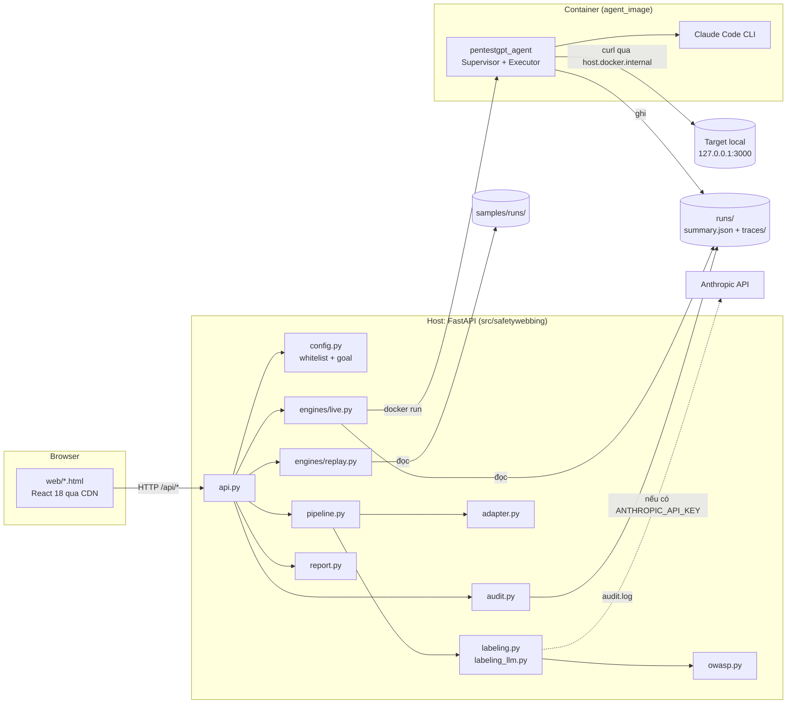
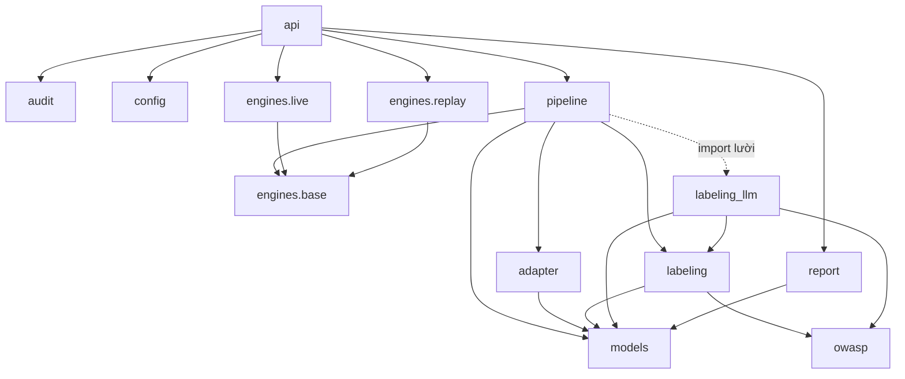
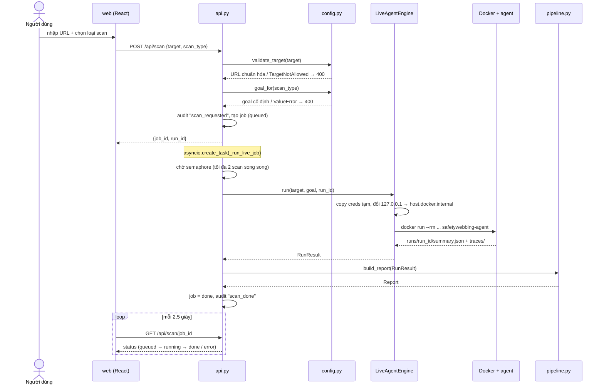
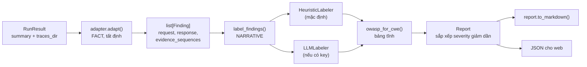
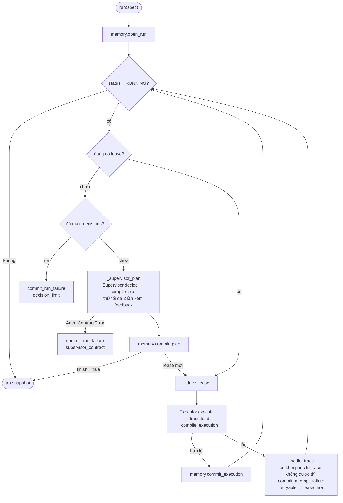

# SafetyWebbing — Bản đồ code

> Tài liệu này mô tả **code đang có thật** (khác với [`ARCHITECTURE.md`](ARCHITECTURE.md) là tài liệu
> thiết kế). Số dòng và `file:line` tính tại commit `072056a`. Sơ đồ dùng Mermaid (GitHub / VS Code
> preview đều render được).

## 1. Một đoạn để nắm toàn cảnh

SafetyWebbing nhận một URL **local** + một loại scan, chạy agent pentest **trong Docker**, rồi biến kết quả
scan thành báo cáo lỗ hổng. Code chia làm **hai thế giới tách biệt**:

| | Host app (`src/safetywebbing`) | Agent vendor (`agent_image/pentestgpt_agent`) |
|---|---|---|
| Vai trò | Orchestrate: validate → spawn Docker → đọc kết quả → gán nhãn → báo cáo | Thực sự quét: Supervisor (LLM) lên kế hoạch, Executor (LLM) chạy lệnh |
| Quy mô | ~1.210 dòng Python, 15 file | ~3.960 dòng Python, 10 file (mã vendor từ PentestGPT) |
| Chạy ở đâu | Máy host (FastAPI + uvicorn) | Chỉ trong container, quyền `FULL_ACCESS` |
| Quan hệ | Chỉ gọi `docker run`, **không import** agent | Ghi `summary.json` + `traces/` ra thư mục mount |

Hợp đồng giữa hai bên **chỉ là file trên đĩa**: `runs/<run_id>/summary.json` + `runs/<run_id>/traces/`.
Nhờ vậy `ReplayEngine` chỉ cần đọc lại đúng các file đó để chạy demo không cần Docker/LLM.

Ngoài ra: `web/` (1 trang React, không build), `samples/` (1 run mẫu SQLi trên Juice Shop),
`tests/` (1 file, 206 dòng).

## 2. Cây thư mục

```
SafetyWebbing/
├── ARCHITECTURE.md · README.md · pyproject.toml · uv.lock
├── .claude/launch.json              # cấu hình dev server: uv run uvicorn safetywebbing.api:app :8000
│
├── src/safetywebbing/                   # ── HOST APP ──────────────────────────────────────
│   ├── api.py            (191)      # FastAPI: endpoint, job store in-memory, phục vụ web/
│   ├── config.py         (115)      # ★ 2 luật an toàn: whitelist loopback + goal template cố định; validate_run_id
│   ├── audit.py           (52)      # ★ ghi runs/audit.log (JSONL, append-only, best-effort)
│   ├── models.py          (80)      # Severity, Label (narrative), Finding (fact+label), Report
│   ├── pipeline.py        (42)      # build_report(): RunResult → adapt → label → Report
│   ├── adapter.py         (94)      # ★ FACT: summary.json ⨝ traces/ → list[Finding] (không LLM)
│   ├── labeling.py       (127)      # Labeler Protocol + HeuristicLabeler (offline) + label_findings()
│   ├── labeling_llm.py   (101)      # LLMLabeler (Anthropic, import lười, fallback heuristic)
│   ├── owasp.py           (41)      # bảng tĩnh CWE → OWASP Top 10 2021 (không cho LLM bịa)
│   ├── report.py          (84)      # Report → Markdown
│   └── engines/
│       ├── base.py        (40)      # RunResult + Engine Protocol  ← hợp đồng chung
│       ├── live.py       (178)      # LiveAgentEngine: build `docker run` (image+auth theo agent), creds/-e key, đọc summary
│       ├── local.py      (169)      # LocalAgentEngine: PentestGPT CLI ngay trên host (chế độ direct)
│       └── replay.py      (46)      # ReplayEngine: đọc run đã lưu (demo/test)
│
├── agent_image/                     # ── IMAGE DOCKER ─────────────────────────────────
│   ├── Dockerfile        (50)       # python:3.12-slim + node + Claude Code CLI; user `agent` (uid 1000)
│   ├── pyproject.toml    (20)       # unified-agent[claude] qua git, pin rev acff8ee; script pentestgpt-agent
│   └── pentestgpt_agent/            # 10 file vendor
│       ├── trial.py     (366)       # ★ entry point CLI + run_trial() + viết summary.json
│       ├── loop.py      (314)       # PentestLoop: vòng lặp tất định 1 task / lần
│       ├── agents.py    (640)       # Supervisor, Executor, prompt, JSON schema, parser
│       ├── plan.py      (344)       # TaskKind/Status + compile_plan() (validator của kế hoạch)
│       ├── execution.py (391)       # ExecutionDelta + compile_execution() (validator bằng chứng)
│       ├── memory.py   (1002)       # MemoryKernel: nguồn sự thật SQLite (runs/tasks/attempts/observations/transitions)
│       ├── trace.py     (436)       # TraceStore + EpisodeRunner: ghi journal từng episode
│       ├── audit.py     (447)       # audit_run() cho benchmark CTF (SafetyWebbing không dùng)
│       ├── identifiers.py (18)      # validate_opaque_id (chống path traversal)
│       └── __init__.py    (3)
│
├── agent_image_hackingbuddy/        # ── IMAGE DOCKER, dùng chung cho agent #2 "hackingbuddy" VÀ #3 "hackingbuddy_claude" ──
│   ├── Dockerfile                   # python:3.13-slim + hackingBuddyGPT + Claude Code CLI (node); user `agent`
│   ├── pyproject.toml               # hackingBuddyGPT @ git commit (không có trên PyPI ở bản này); script safetywebbing-hackingbuddy-agent
│   └── safetywebbing_hb_agent/          # wrapper nói hợp đồng CLI của SafetyWebbing
│       ├── cli.py                   # map args → wintermute WebTestingWithExplanation; rẽ theo SAFETYWEBBING_LLM_AUTH
│       ├── claude_bridge.py         # ★ thay LiteLLM.raw_completion bằng `claude -p` (giả lập tool-calling qua structured output); thuần, có test
│       ├── run_wintermute.py        # entrypoint claude_oauth: install() bridge rồi gọi wintermute.main() trong cùng process
│       └── translate.py             # ★ JSONL span của hackingBuddy → summary.json + traces/ (thuần, có test)
│
├── web/  overview · scan · history · vulns · system (.html) + about.html (tĩnh)   # React 18 + Babel qua CDN, không build
│        shared.jsx (AppBar/menu, Report, helper) · styles.css · about.css · codefall.js
├── samples/runs/sqli-claude-03/     # run mẫu: summary.json, trial-config.json, traces/{executor-*,supervisor-*}
├── runs/                            # kết quả scan live (gitignored), bind-mount từ container
└── tests/test_safety.py (206)
```

★ = file mang trách nhiệm an toàn / lõi dữ liệu.

## 3. Kiến trúc tổng thể



### Phụ thuộc import giữa các module host



Lá (không import nội bộ): `config`, `audit`, `models`, `owasp`, `engines.base`. Không có vòng phụ thuộc.

## 4. Luồng chính

### 4.1 Quét live: `POST /api/scan`



Vòng đời job: `queued → running → done | error | cancelled`. Job lưu trong dict `_jobs` (in-memory);
xóa sau 1 giờ (`_JOB_TTL_S`), tối đa 200 (`_MAX_JOBS`). Mỗi job còn giữ `task` (asyncio.Task) và
`log` (xem `live_log.py`) — cả hai bị loại khỏi response của `GET /api/scan/{job_id}` (không
serialize được / không cần thiết, UI đọc `log` qua endpoint riêng).

**Hủy quét** (`POST /api/scan/{job_id}/cancel`, `api.cancel_scan`): gọi `task.cancel()` trên chính
asyncio.Task của job. `_run_live_job` bọc toàn bộ thân hàm (kể cả lúc chờ semaphore) trong
`try/except asyncio.CancelledError` nên hủy lúc đang `queued` hay đang `running` đều chuyển job sang
`cancelled` một cách sạch sẽ. Mỗi engine tự dọn việc thật của mình khi bị cancel:
`LiveAgentEngine.run` giờ đặt `--name safetywebbing-<run_id>` cho container rồi `docker kill` tên đó
(trước đây chỉ kill được CLI client `docker run`, container vẫn chạy tiếp — xem mục 9.A.3 đã sửa);
`LocalAgentEngine.run` đã có sẵn `_kill_tree` (taskkill /T /F trên Windows, `killpg` trên Unix).

### 4.2 Xem demo: `GET /api/report/sample/{run_id}`

`api._engine_for` (validate `run_id`) → `ReplayEngine.load` → `RunResult` → `build_report` → JSON.
Không Docker, không mạng; nhãn do `HeuristicLabeler` (hoặc LLM nếu có key).

### 4.3 Biến kết quả thô thành báo cáo (`pipeline.build_report`)



**Phép join cốt lõi** (`adapter.py:64`): `summary.json` chỉ giữ *response* của mỗi observation, còn
*request* nằm trong trace:

```
observation.trace_episode_id ──► traces/<episode>/events.jsonl
observation.evidence_sequences ─► sự kiện tool_result có sequence tương ứng   (= response)
tool_result.call_id ───────────► sự kiện tool_call cùng call_id               (= request: input.command)
```

Đã kiểm chứng trên sample: observation `...:observation` của `executor-75a7…` → sequence 7 →
`curl ... -d '{"email":"'"'"' OR 1=1--",...}'`.

## 5. Host app — từng module

| File | Public API | Ghi chú đáng nhớ |
|---|---|---|
| `config.py` | `validate_target(url)`, `goal_for(scan_type)`, `SCAN_TYPES`, `validate_run_id(id)`, `TargetNotAllowed`, `InvalidRunId` | Chỉ http/https; host phải là `localhost` hoặc loopback (`ipaddress.is_loopback`). 4 loại scan: `sqli`, `xss`, `auth`, `general` |
| `audit.py` | `record_scan(runs_root, *, event, run_id, target, goal, scan_type, **extra)` | Nuốt `OSError` — log lỗi không được làm hỏng scan |
| `models.py` | `Severity` (+`.rank`), `Label`, `Finding`, `Report` (+`.conclusive`) | Mọi trường narrative nullable → UI luôn render được fact. `conclusive` chỉ đúng khi `status == "completed"` |
| `engines/base.py` | `RunResult`, `Engine` (Protocol: `async run(*, target, goal, run_id)`) | Điểm mở rộng cho `ZapEngine` |
| `engines/live.py` | `LiveAgentEngine.run / build_command / _prepare_creds`, `target_for_container`, `ScanFailed` | `build_command` là hàm thuần → test được không cần Docker. Timeout mặc định 600s |
| `engines/replay.py` | `ReplayEngine.list_runs / load / run` | `run()` bỏ qua `target`/`goal` |
| `adapter.py` | `adapt(summary, traces_dir) -> list[Finding]` | 1 Finding / observation; không gọi LLM |
| `labeling.py` | `Labeler` (Protocol), `HeuristicLabeler`, `label_findings` | Luật: SQLi bypass (critical), SQLi lỗi 500 (medium), XSS phản chiếu (high), 500 (low), 401/403 (info) |
| `labeling_llm.py` | `LLMLabeler(model, api_key)` | System prompt tiếng Việt; evidence đóng khung `<EVIDENCE>…</EVIDENCE>` (chống prompt injection); lỗi bất kỳ → fallback heuristic |
| `owasp.py` | `owasp_for_cwe("CWE-89")`, `CWE_TO_OWASP` | 22 CWE → các nhóm A01/A02/A03/A05/A07/A08/A10 (2021) |
| `pipeline.py` | `build_report(result, labeler=None)`, `default_labeler()` | Có `ANTHROPIC_API_KEY` → LLM (model mặc định `claude-opus-5-5`, đổi bằng `SAFETYWEBBING_LLM_MODEL`), không thì heuristic |
| `report.py` | `to_markdown(report)` | Cắt response ở 1.200 ký tự; có cảnh báo khi run không hoàn tất |

### API HTTP (`api.py`)

| Method + path | Việc | Lỗi |
|---|---|---|
| `GET /api/scan-types` | Danh sách loại scan cho dropdown | — |
| `GET /api/runs` | Các run mẫu (replay) | — |
| `GET /api/report/{source}/{run_id}` | Report JSON; `source` = `sample` hoặc (mọi giá trị khác) live | 400 run_id xấu, 404 không có run |
| `GET /api/report/{source}/{run_id}/markdown` | Markdown | như trên |
| `POST /api/scan` | Bắt đầu scan live → `{job_id, run_id}` | 400 target ngoài whitelist / scan_type lạ |
| `GET /api/scan/{job_id}` | Trạng thái + report khi xong | 404 job lạ |
| `GET /api/scan/{job_id}/log?after=N` | Dòng log terminal mới từ chỉ số `N` (xem `live_log.py`) | 404 job lạ |
| `POST /api/scan/{job_id}/cancel` | Hủy job đang `queued`/`running` (`task.cancel()`) | 404 job lạ; job đã xong → `{cancelled: false}`, không lỗi |
| `GET /api/overview` · `/api/vulns` · `PUT /api/vulns/{id}/triage` | Tổng quan + lỗ hổng gộp xuyên scan + triage (`insights.py`) | 400 status lạ, 404 id lạ |
| `GET /api/system` · `/api/audit` | Sức khỏe hệ thống, giới hạn, nhật ký kiểm toán (`system.py`) | — |
| `GET /` `/scan` `/history` `/vulns` `/about` `/system` · `/static/*` | các trang `web/*.html` và tài nguyên tĩnh | — |

### Frontend (`web/scan.html`, trang Quét mới — trước đây là `index.html`)

`App` (state: target, scanType, report, activeRun, status, busy) → form quét live + danh sách run mẫu
+ `Report` (→ `Kpis`, `Counts`, `Finding` → `Badge`) + `ThemeToggle` (localStorage `sn-theme`).
`api()` là wrapper `fetch` ném lỗi theo `detail` của FastAPI. Nút "In / PDF" dùng `window.print()`
(không có PDF phía server).

## 6. Agent vendor — cách nó hoạt động

### 6.1 Vòng lặp (`loop.py::PentestLoop`)



Nguyên tắc thiết kế (ghi trong docstring `agents.py`): *LLM chỉ đề xuất, code tất định giữ trạng thái*.
Mọi output của LLM đi qua một bộ biên dịch trước khi chạm vào SQLite.

### 6.2 Hai vai LLM

| | Supervisor | Executor |
|---|---|---|
| Làm gì | Chọn 1 task `ready` hoặc đề xuất **tối đa 1** task mới, hoặc `finish` | Làm đúng 1 task, trả `done/progress/blocked/failed` + trích dẫn bằng chứng |
| Đầu ra | JSON theo `SUPERVISOR_SCHEMA` → `SupervisorDecision` | JSON theo `EXECUTOR_SCHEMA` → `ExecutionDelta` |
| Validator | `plan.compile_plan` | `execution.compile_execution` |
| Số lượt | `supervisor_max_turns` = 4 | Theo loại task: discover 5, enumerate 6, test 5, exploit 9, verify 4, recover 6 (+1 lượt trả kết quả) |

### 6.3 Các luật cứng trong `compile_plan` (`plan.py:157`)

- Target của task phải **trùng byte-for-byte** một target được phép (`_target_is_allowed`, chuẩn hóa URL, chặn `..`, `%`, `\`, userinfo, fragment).
- Mỗi quyết định: **đúng một** trong `next_task_id` hoặc `finish`; tối đa 1 task mới, và task mới phải được chọn ngay.
- Task `TEST` không được chứa cụm khai thác (`read the flag`, `reverse shell`, `exfiltrat`…).
- Task `EXPLOIT` phải trích observation `TEST` mới nhất, đã hoàn tất, cùng target.
- Chỉ trích observation có thật; task cung cấp basis phải nằm trong `depends_on`; không vòng phụ thuộc.
- `finish` chỉ khi không còn task mở và có 1–4 observation làm cơ sở (từ task đã `done`).

`compile_execution` (`execution.py:271`) bắt `evidence_excerpt` phải là **trích dẫn nguyên văn** từ
output của một tool call thành công trong trace (`_exact_receipt_slice` & họ hàng) — LLM không thể
"bịa" bằng chứng.

### 6.4 Trạng thái & bằng chứng trên đĩa

```
runs/<run_id>/
├── trial-config.json        # định danh trial (hash prompt/schema, sandbox, version) — dùng cho --resume
├── state.sqlite3            # MemoryKernel (gitignored)
├── summary.json             # kết quả cuối — luôn được ghi, kể cả khi lỗi
└── traces/<episode_id>/
    ├── input.json           # prompt, schema, chữ ký sha256, provider
    ├── events.jsonl         # append-only + fsync: session_started, tool_call, tool_result, turn_completed…
    └── output.json          # kết quả episode (usage, cost, structured_output)
```

SQLite (`memory.py:146`): `runs` · `tasks` · `attempts` · `observations` · `transitions`
(khóa `(run_id, revision)` — mỗi thay đổi trạng thái tăng `revision`, nên một quyết định "cũ" bị từ chối
với `StaleRevisionError`). Cơ chế phục hồi sau crash: nếu episode đã tồn tại thì **không chạy lại**,
chỉ đọc lại trace (`recover_terminal_output`).

### 6.5 Hợp đồng `summary.json` (cái mà host đọc)

```
{ run_id, goal, targets[], status: completed|failed|error, error, cost_usd, wall_duration_s,
  tasks[{id,kind,target,status}],
  observations[{id,task_id,attempt_id,statement,trace_episode_id,evidence_sequences[]}],
  attempts[], transitions[], usage{}, episodes, ... }
```

Host chỉ dùng: `goal, targets, status, error, cost_usd, wall_duration_s, tasks, observations`.
`transitions` chưa được dùng (ARCHITECTURE.md định dùng cho progress bar).

## 7. Bất biến an toàn: ở đâu được thực thi, ở đâu được test

| # | Luật (ARCHITECTURE §2) | Thực thi tại | Test |
|---|---|---|---|
| 1 | Whitelist loopback | `config.validate_target` ← `api.start_scan` (`api.py:158`) | `test_local_targets_allowed`, `test_remote_targets_blocked` |
| 2 | Scope cố định | `config.SCAN_TYPES` / `goal_for` ← `api.py:162` | `test_goal_templates_are_fixed` |
| 3 | Cô lập agent | `engines/live.py` (`docker run`) + `Dockerfile` (user không phải root) | chỉ test hình dạng lệnh |
| 4 | LLM không khẳng định vô căn cứ | `labeling_llm._SYSTEM`, khung `<EVIDENCE>`, `owasp.py` tĩnh | **chưa có** |
| 5 | Ghi log mọi scan | `audit.record_scan` ← `api.py:171,144,148` | `test_record_scan_appends_jsonl` |
| + | Path traversal qua `run_id` | `config.validate_run_id` ← `api._engine_for` (`api.py:105`) | `test_traversal_run_ids_blocked` |
| + | Scope bên trong agent | `plan._target_is_allowed`, `compile_execution` | nằm ngoài repo này |

## 8. Muốn sửa X thì mở file nào

| Việc | Mở |
|---|---|
| Thêm loại scan / đổi goal | `config.py` → `SCAN_TYPES` |
| Đổi luật whitelist | `config.py` → `validate_target` (và sửa `test_safety.py`) |
| Thêm engine (vd ZAP) | tạo `engines/zap.py` theo `Engine` Protocol (`engines/base.py`), đăng ký trong `api.py` |
| Thêm agent (vd hackingBuddy) | thêm mục vào `config.AGENTS` (image + auth + modes); nếu agent ngoài → tạo image mới có wrapper ghi `summary.json` + `traces/` như `agent_image_hackingbuddy/`. Hai agent có thể dùng CHUNG một image với `auth` khác nhau — xem `hackingbuddy` (llm_api_key) vs `hackingbuddy_claude` (claude_oauth, qua `claude_bridge.py`) |
| Đổi cách ghép request/response | `adapter.py` → `_recover_request` |
| Đổi luật nhãn offline | `labeling.py` → `HeuristicLabeler` |
| Đổi prompt/model của LLM labeler | `labeling_llm.py` (`_SYSTEM`) · biến môi trường `SAFETYWEBBING_LLM_MODEL` |
| Thêm CWE → OWASP | `owasp.py` → `CWE_TO_OWASP` |
| Đổi định dạng báo cáo | `report.py` (Markdown) + `Report`/`Finding` trong `web/shared.jsx` |
| Đổi tham số `docker run` (mạng, tài nguyên, timeout) | `engines/live.py` → `build_command`, `timeout_s` |
| Đổi hành vi agent | `agents.py` (prompt/schema) · `plan.py` (luật kế hoạch). **Lưu ý:** đổi prompt đổi hash trong `trial-config.json` → run cũ không `--resume` được |
| Đổi image | `agent_image/Dockerfile`, `agent_image/pyproject.toml` (rev `unified-agent`) |

## 9. Phân tích: điểm tốt và vấn đề tìm thấy

### Điểm tốt

- **Tách fact / narrative rõ ràng** (`adapter` vs `labeling`), và CWE → OWASP là bảng tĩnh — đúng cam kết "không để LLM bịa".
- **Trung thực với run lỗi**: `Report.conclusive` + cảnh báo trong UI/Markdown ("không tìm thấy" ≠ "run lỗi").
- **Hàm thuần dễ test**: `build_command`, `target_for_container`, `validate_*`.
- **Credentials**: copy tạm rồi xóa (`live.py:113`), thay vì mount thẳng thư mục `~/.claude` thật.
- **Agent vendor** thiết kế chắc: LLM chỉ đề xuất, validator + SQLite giữ sự thật, trace append-only có `fsync`, phục hồi sau crash.
- Job store có giới hạn (TTL, số lượng, semaphore) — không phình vô hạn.

### Vấn đề (xếp theo mức độ ảnh hưởng)

**A. An toàn — quan trọng nhất với một công cụ pentest**

1. **Container chưa thực sự là "ranh giới an toàn"** — `engines/live.py:87-93`. ARCHITECTURE §2.3 nói
   ranh giới thật nằm ở container, nhưng `docker run` dùng mặc định: egress internet mở, không
   `--cap-drop`, `--security-opt no-new-privileges`, `--memory`, `--cpus`, `--pids-limit`.
   `--add-host host.docker.internal:host-gateway` mở **mọi** cổng trên máy host, không riêng `:3000`.
   Whitelist chỉ kiểm chuỗi URL ở host, còn `plan._target_is_allowed` chỉ kiểm trường `target` của task,
   không kiểm lệnh Executor thực sự chạy. Agent có `FULL_ACCESS` và đọc nội dung web không đáng tin
   (prompt injection từ target là kịch bản thực tế).
2. **Token OAuth nằm trong container có quyền toàn phần** — `live.py:96-98`. Bản copy tạm là cách làm
   đúng, nhưng token trong đó vẫn hợp lệ; cộng với egress mở ở điểm 1, agent bị lừa có thể đẩy token ra ngoài.
   Siết mạng (điểm 1) giải quyết cả hai.
3. ~~**Timeout có thể để container chạy tiếp**~~ — **đã sửa.** `build_command` giờ đặt
   `--name safetywebbing-<run_id>`; `run()` gọi `docker kill safetywebbing-<run_id>` (best-effort, nuốt lỗi nếu
   docker vắng mặt) cả khi timeout lẫn khi job bị hủy qua `POST /api/scan/{job_id}/cancel`, trước khi
   `proc.kill()` tiến trình client. Có test (`test_timeout_kills_container`,
   `test_cancel_kills_container_and_propagates` trong `tests/test_safety.py`) giả lập bằng subprocess
   `sleep` thường — không cần Docker thật để pin hành vi này.

**B. Đúng/sai chức năng**

4. **Regex SQLi bị false-positive** — `labeling.py:42`: nhánh `--` khớp mọi cờ dài của curl (`--max-time`,
   `--silent`). *Đã kiểm chứng:* request baseline thật trong sample (`curl ... --max-time 15 ...`) khớp regex;
   hiện không bị gán nhầm chỉ vì response là 401. Nhưng một curl vô hại trả `200` có chữ `token` sẽ bị gán
   **CRITICAL SQLi (CWE-89)**, trả `500` sẽ thành "Possible SQL Injection". Nên match trên phần payload
   (giá trị `-d` / query string), không phải cả dòng lệnh.
5. **`build_report` chặn event loop** — `api.py:141-143`. Hàm đồng bộ, và `LLMLabeler` gọi Anthropic
   tuần tự từng finding ngay trong coroutine `_run_live_job` → toàn server (kể cả poll `/api/scan/{id}`)
   đứng trong lúc gán nhãn. Sửa: `await asyncio.to_thread(build_report, rr)`.
6. **Thiếu dependency `anthropic`** — `pyproject.toml:12-16` so với `labeling_llm.py:49`. Đặt
   `ANTHROPIC_API_KEY` mà chưa cài package → `ImportError` bị `except Exception` nuốt (`labeling_llm.py:59`),
   mọi finding âm thầm rơi về heuristic; chỉ lộ ở chuỗi `labeled_by`. Nên thêm extra `llm = ["anthropic"]`.
7. **Gán nhãn lại ở mỗi lần xem** — `api.py:112-131` + `pipeline.py:26`. Mỗi lần mở report (hoặc tải Markdown)
   là gọi lại LLM cho mọi finding → tốn tiền và kết quả có thể đổi giữa các lần xem, phá tính tất định của demo.
   Nên cache nhãn theo `(run_id, finding.id, model)` hoặc lưu `report.json` cạnh `summary.json`.
8. **`validate_run_id` dùng `$` thay vì `\Z`** — `config.py:99,113`. *Đã kiểm chứng:* `"abc\n"` lọt qua.
   Bản của agent làm đúng (`identifiers.py:8` dùng `\Z` + `fullmatch`). Tác động thấp, nhưng nên đồng nhất.
9. `_engine_for` coi **mọi** `source` khác `"sample"` là live (`api.py:108`) — giá trị lạ nên trả 404.

**C. Test & tài liệu**

10. **Độ phủ test lệch**: 206 dòng, chỉ phủ `config`, `audit`, `_prune_jobs`, helper của `live`. **Chưa có test** cho
    `adapter` (phép join — phần "fact" cốt lõi), `HeuristicLabeler`, `owasp`, `report`, `ReplayEngine`, các endpoint.
    `samples/runs/sqli-claude-03` là fixture sẵn để viết golden test. *(Tôi không chạy được test ở đây vì máy chưa có
    `uv`/`pytest`; nhận định dựa trên đọc `tests/test_safety.py`.)*
11. **Tài liệu lệch code**: `README.md:11` còn ghi "FastAPI, sắp tới" dù `api.py` đã có; mục "Thành phần" thiếu
    `adapter/labeling/pipeline/report/web/samples`; `engines/__init__.py:5` còn "[Day 3]". ARCHITECTURE.md nói
    "Frontend React" nhưng thực tế là 1 file HTML dùng React + Babel **qua CDN** (`<script>` trong mỗi `web/*.html`) — nên chế độ
    demo "không sợ fail" thật ra **cần Internet** (unpkg, Google Fonts).
12. **Mã vendor không dùng tới**: `agent_image/pentestgpt_agent/audit.py` (447 dòng, `audit_run(expected_flag=…)` cho
    benchmark CTF), backend `codex`, cờ `--resume`. Giữ nguyên để dễ đồng bộ upstream là hợp lý — chỉ cần biết
    chúng là "chết" trong ngữ cảnh SafetyWebbing.

### Việc nên làm trước (đề xuất)

1. Siết `docker run` (mạng + quyền + tài nguyên + `--name`/kill khi timeout) — #1, #2, #3.
2. `asyncio.to_thread` cho `build_report` và sửa regex `--` — #5, #4.
3. Viết test cho `adapter` + `HeuristicLabeler` dựa trên sample — #10 (đồng thời khóa hành vi của #4).
