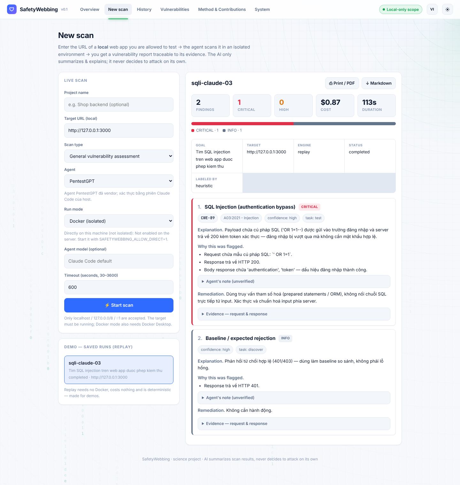
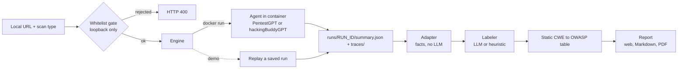
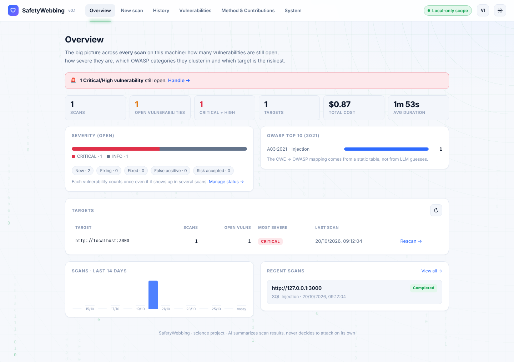
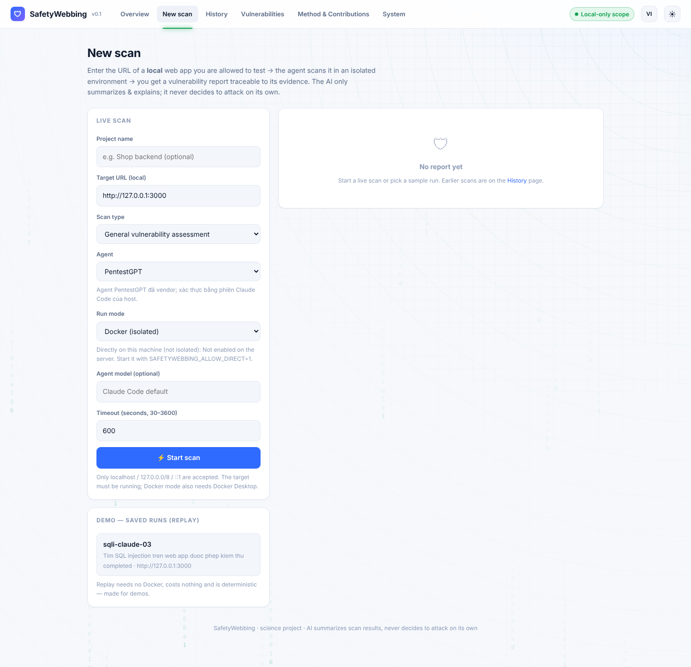
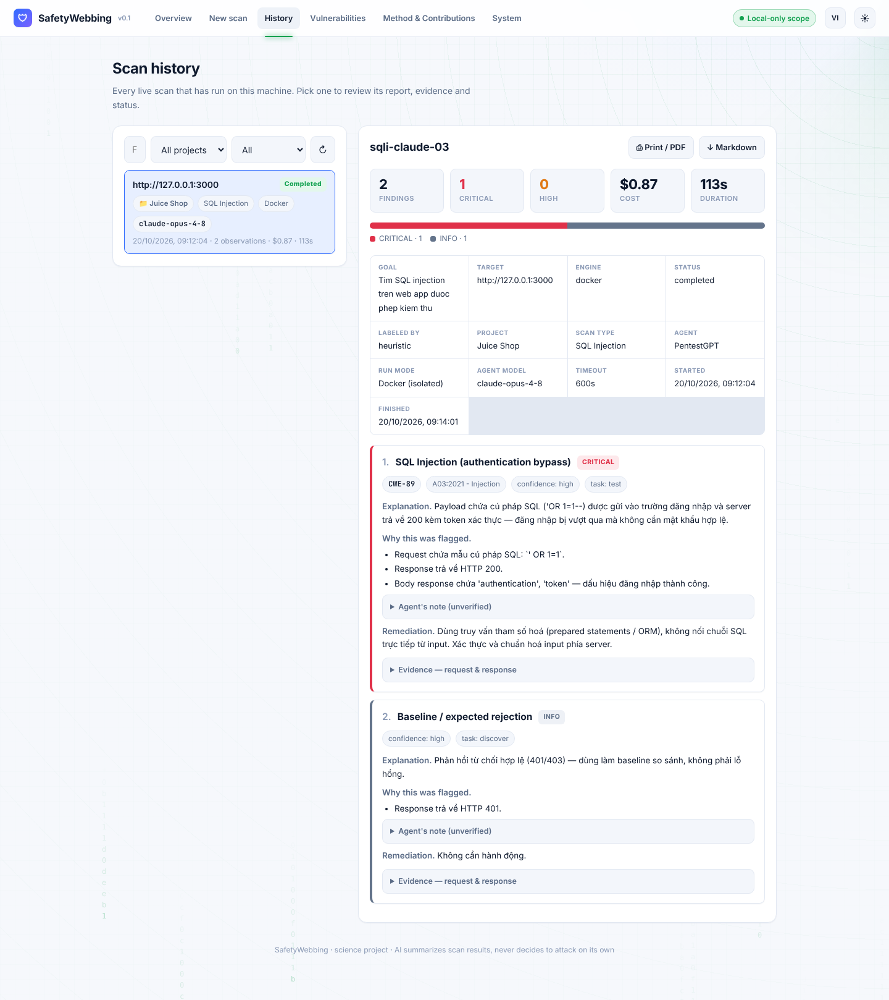
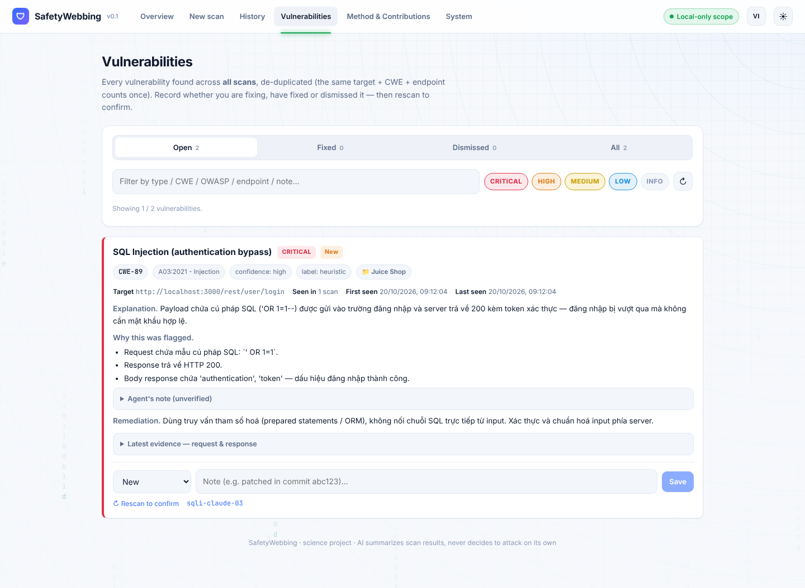
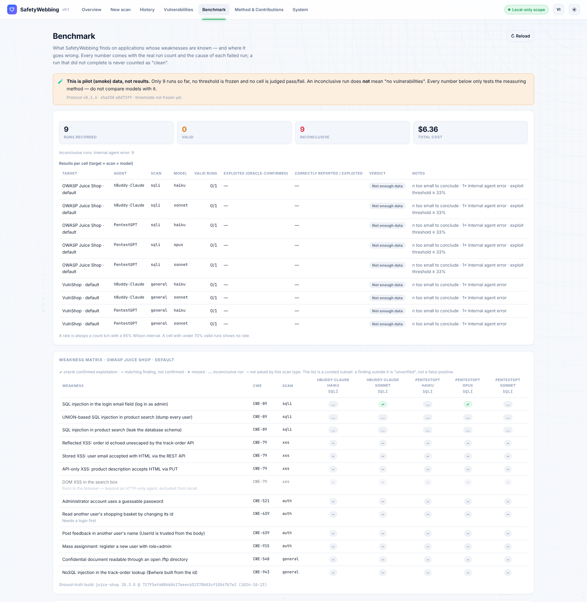
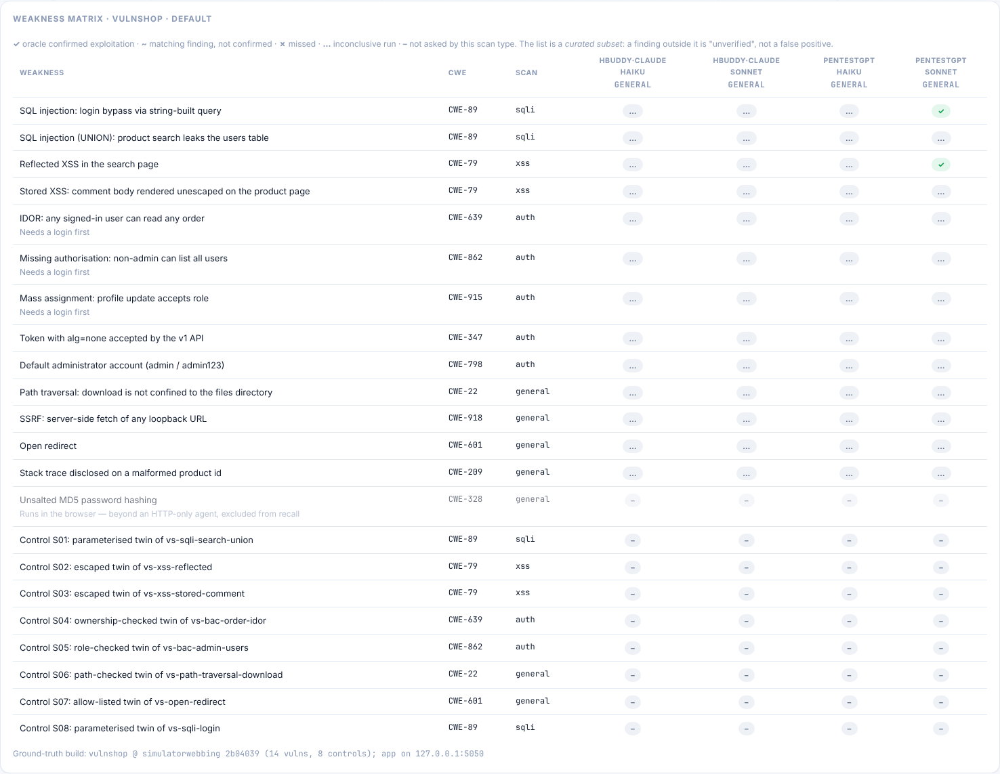
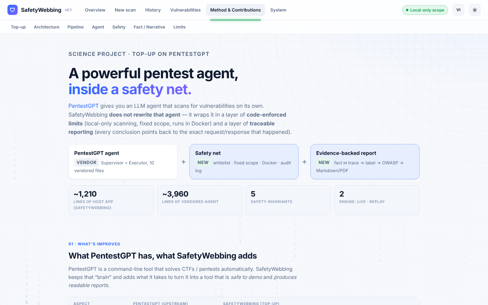

# SafetyWebbing

**Point an AI pentest agent at a web app on your own machine, safely, and get a vulnerability report you can trace back to the evidence.**

SafetyWebbing is a school science project. You give it the URL of a **local** web app you are allowed to test. An AI scanning agent runs **inside an isolated container**, and SafetyWebbing turns the agent's raw output into a structured report.

> **The AI explains. It does not decide.** The agent never chooses its own target, never decides what to attack, and never writes new exploit code. Those limits are enforced in code, not left to the model's good behavior. See [How it stays safe](#how-it-stays-safe).



## Contents

- [What it does](#what-it-does)
- [How it stays safe](#how-it-stays-safe)
- [Quick start](#quick-start)
- [A tour of the app](#a-tour-of-the-app)
- [Scanning for real](#scanning-for-real)
- [Choosing an agent](#choosing-an-agent)
- [Run modes: Docker vs direct](#run-modes-docker-vs-direct)
- [Reports and labeling](#reports-and-labeling)
- [Configuration reference](#configuration-reference)
- [HTTP API](#http-api)
- [Project layout](#project-layout)
- [Development and tests](#development-and-tests)
- [Experiment log: model comparison](#experiment-log-model-comparison)
- [Known limitations](#known-limitations)
- [Future goals](#future-goals)
- [Credits](#credits)

## What it does

1. **Input.** You enter a local URL such as `http://127.0.0.1:3000` and pick a scan type (SQL injection, XSS, broken authentication or access control, or a general assessment).
2. **Scan.** A pentest agent runs in a Docker container against that URL. The task it gets is a fixed goal template, not free text.
3. **Adapt.** The agent writes `summary.json` and `traces/`. SafetyWebbing joins them into a list of **findings**, each with the request, the response and the evidence that links them. No LLM is involved in this step.
4. **Label.** Each finding gets a vulnerability class, severity, CWE and remediation advice. The labels come from an LLM (optional) or from an offline heuristic. The mapping from CWE to OWASP Top 10 (2021) comes from a static table, so the model can't make it up.
5. **Report.** You read the report in the browser, export it as Markdown, or print it to PDF. Later you can triage each vulnerability as New, Fixing, Fixed, False positive or Risk accepted, then rescan to confirm.



The host app (`src/safetywebbing/`) only orchestrates. It never imports or runs the agent in-process. The only contract between the two is the files in `runs/<run_id>/`.

## How it stays safe

Five invariants are written as code, and each has tests (`tests/test_safety.py`):

| # | Rule | Where it lives |
|---|---|---|
| 1 | **Local targets only.** Only `http`/`https` URLs on `localhost`, `127.0.0.0/8` or `::1` are accepted, and anything else is rejected before anything is spawned. | `config.validate_target` |
| 2 | **Fixed scope.** A scan type maps to a goal template written in code. The user and the agent can't change what is searched for. | `config.SCAN_TYPES` |
| 3 | **Isolation.** The agent runs with full shell access, so by default it runs only inside a Docker container. The container is the real security boundary. | `engines/live.py` |
| 4 | **No unsupported claims.** The LLM layer only interprets evidence. Raw request and response data enters the prompt as untrusted data inside delimiters, as a defense against prompt injection. | `labeling_llm.py` |
| 5 | **Audit log.** Every scan request is recorded in `runs/audit.log` (append-only) before anything runs. | `audit.py` |

Other limits: at most **2 scans run in parallel**, each scan has a timeout (30 to 3600 s, default 600 s) with a hard ceiling, model names are validated so they can't smuggle command-line flags, and API keys are passed to containers by environment variable *name* so they never appear on a command line.

## Quick start

### Prerequisites

- Python 3.12 or newer and [`uv`](https://docs.astral.sh/uv/)
- **For the demo:** nothing else.
- **For live scans:** Docker Desktop (or Docker Engine) running, a local target app to scan, and either a logged-in Claude Code CLI on the host (PentestGPT agent) or an LLM API key (hackingBuddyGPT agent).

### Run the app

```bash
git clone https://github.com/doodoocantread/SafetyWebbing.git
cd SafetyWebbing
uv sync --extra dev
uv run uvicorn safetywebbing.api:app --port 8000
```

Open <http://127.0.0.1:8000>. The UI has Vietnamese and English; use the **VI / EN** button in the top bar to switch, and the sun icon for light or dark theme. Your choice is remembered in the browser.

> The pages load React and Babel from a CDN, so the browser needs internet access. There is no frontend build step.

### Try it without Docker or an LLM

Open **New scan** and click the saved run `sqli-claude-03` under **Demo — saved runs (replay)**. This replays a real earlier scan, a SQL-injection login bypass against OWASP Juice Shop. The replay is free, deterministic and works offline, so it suits demos.

## A tour of the app

The menu has six pages. The screenshots below use the English interface and the bundled sample run.

### Overview (`/`)

The big picture across every scan on the machine: open vulnerabilities by severity, the OWASP Top 10 spread, risk per target, scans per day and a "needs attention" list covering recurring vulnerabilities and failed or interrupted scans. A `failed` scan is **never** counted as "clean".



### New scan (`/scan`)

Enter the target, scan type, agent, run mode, optional model and timeout, then press **Start scan**. While a scan runs you get a live terminal log and a **Cancel** button. Below the form are the saved demo runs.



### Scan history (`/history`)

Every live scan, newest first, with target, scan type, run mode, model, status, cost and duration. You can filter by project or status. Opening a row shows the report together with the exact settings used. Failed, timed-out and interrupted scans get their own rows with the reason. Reports are cached in `runs/<run_id>/report.json`, so reopening one never calls the LLM again or changes the wording.



### Vulnerabilities (`/vulns`)

Findings are de-duplicated across scans. The fingerprint is target + CWE (or class) + endpoint, so the same bug counts once. You set a status for each one: **New**, **Fixing**, **Fixed**, **False positive** or **Risk accepted**, plus an optional note. It also tells you when a fixed vulnerability no longer shows up in later scans, and flags it as **recurring** if a fixed one comes back. **Rescan to confirm** opens the scan form pre-filled. Your decisions are stored in `runs/triage.json`, separate from the scan evidence.



### Benchmark (`/benchmark`)

What SafetyWebbing finds on applications whose weaknesses are known, and where it goes wrong. Each recorded run is scored against a ground-truth manifest (`benchmark/targets/`) in two independent ways: whether the target's own oracle confirmed the exploit, and whether the report carries a matching finding. Rates are shown as counts with a 95% Wilson interval. A run that did not complete is listed as **inconclusive** with its cause (provider safety filter or agent error), never counted as "clean". The page only reads the committed files in `benchmark/results/`; it cannot start a run. The method, thresholds and known limits are in [`benchmark/PROTOCOL.md`](benchmark/PROTOCOL.md). Results so far are pilot (smoke) data and are labelled as such.

Two targets are wired up: **OWASP Juice Shop** (oracle: its own `/api/Challenges` solved-state) and **VulnShop** (the [SimulatorWebbing](https://github.com/doodoocantread/SimulatorWebbing) testbed, which confirms each exploit server-side by writing the vuln id to a file the runner snapshots). Both are scored with the `opus-4-8 / sonnet-4-6 / haiku-4-5` model set, after the 5.x models were found to be refused by the provider's real-time cyber safeguards and so could not be measured at all.



The VulnShop weakness matrix below shows every cell independently. Oracle-confirmed exploits are the only green ticks (PentestGPT · Sonnet exploited the login-bypass SQL injection and the reflected XSS, both verified server-side); `…` marks an inconclusive run, which the page never reads as "clean".



### Method & Contributions (`/about`)

A static page written for the science-project audience: what PentestGPT already does, what SafetyWebbing adds on top, the pipeline, the safety design, the split between facts and narrative, and the project's limits.



### System (`/system`)

A pre-flight check so you don't find out about a missing dependency from a failed scan: Docker CLI, daemon and image status, whether the `direct` mode agent CLI is available, which labeler is in use, the limits in force, the fixed scan scope, storage counts, and the `audit.log` viewer. It only shows whether a secret is set. It never shows the value.

## Scanning for real

### 1. Build the agent image (once)

```bash
docker build -t safetywebbing-agent ./agent_image
```

### 2. Start a target you are allowed to test

For example [OWASP Juice Shop](https://github.com/juice-shop/juice-shop) on `http://127.0.0.1:3000`. Only scan applications you own or have permission to test.

### 3. Scan from the UI or the API

In the UI, open **New scan**, fill in the form and press **Start scan**. Or use the API:

```bash
curl -X POST http://127.0.0.1:8000/api/scan \
  -H "Content-Type: application/json" \
  -d '{"target": "http://127.0.0.1:3000", "scan_type": "sqli", "project": "Juice Shop"}'
```

The result is stored under `runs/<run_id>/` and appears in History.

### Smoke-testing the image without the backend

```bash
docker run --rm --add-host host.docker.internal:host-gateway \
  -v "$PWD/runs:/work/runs" \
  -v "$HOME/.claude:/root/.claude:ro" \
  safetywebbing-agent \
  --goal "Tim SQL injection tren web app duoc phep kiem thu." \
  --target http://host.docker.internal:3000 \
  --backend claude --run-id smoke-01 --runs-root /work/runs
```

The result is in `runs/smoke-01/summary.json`.

### Per-scan options

`POST /api/scan` accepts these fields, and the UI exposes them too:

| Field | Meaning |
|---|---|
| `target` | Local URL. It must pass the whitelist. |
| `scan_type` | `sqli`, `xss`, `auth` or `general` (default). |
| `agent` | `pentestgpt` (default), `hackingbuddy` or `hackingbuddy_claude`. |
| `mode` | `docker` (default) or `direct` (needs server opt-in). |
| `model` | Model ID for the agent. Leave empty for the agent's default. It is strictly validated. |
| `timeout_s` | Time budget in seconds, 30 to 3600 (default 600). Because the agent has full access, this is a safety control as well as a performance one. |
| `project` | Free-text label to group scans by app. Display only. |
| `llm_provider`, `llm_api_key` | For the hackingBuddyGPT agent only. See below. |

## Choosing an agent

You choose the agent per scan, independently of the run mode. Every agent writes the **same on-disk contract** (`runs/<run_id>/summary.json` + `traces/`), so the adapter, labeler and report are identical whichever agent ran. Agents differ only in their Docker image and how they authenticate with an LLM. They are declared in `config.py` (`AGENTS`) and the UI reads them from `GET /api/agents`.

| Agent | Image | LLM authentication | Modes | Notes |
|---|---|---|---|---|
| `pentestgpt` (default) | `safetywebbing-agent` | Your host's Claude Code OAuth session (a temporary copy is mounted) | `docker`, `direct` | PentestGPT agent, vendored into this repo. |
| `hackingbuddy` | `safetywebbing-hackingbuddy` | An LLM API key through litellm, entered in the UI per scan or set in the server environment | `docker` only | The **web** use-case of [hackingBuddyGPT](https://github.com/ipa-lab/hackingBuddyGPT) (`WebTestingWithExplanation`). |
| `hackingbuddy_claude` | `safetywebbing-hackingbuddy` (same image) | Your host's Claude Code OAuth session (`docker`: a temporary copy is mounted; `direct`: the host's own session) | `docker`, `direct` | The same hackingBuddyGPT use-case, with its LLM calls routed through the Claude Code CLI instead of an API key — see below. No key, no UI field. |

SafetyWebbing includes only hackingBuddyGPT's **web** use-case, which takes a URL. Its privilege-escalation use-cases, which run real commands over SSH or a local shell, are deliberately **not** included. Because the web use-case only exposes HTTP capabilities to the model (never a shell), `hackingbuddy_claude` can also run in `direct` mode — unlike the `hackingbuddy` (API-key) agent, which stays container-only. The `direct` path still carries the usual "no isolation" caveat below, but its blast radius is narrower than PentestGPT's FULL_ACCESS shell.

### Building and configuring hackingBuddyGPT

```bash
docker build -t safetywebbing-hackingbuddy ./agent_image_hackingbuddy
```

One image serves both `hackingbuddy` and `hackingbuddy_claude`; the engine tells it which LLM path to use per scan (`SAFETYWEBBING_LLM_AUTH`, set from the agent's `auth`, never from the request). hackingBuddyGPT isn't on PyPI at the version this wrapper targets (PyPI tops out at 0.3.1; the git tag `v0.5.0` predates the litellm-based LLM layer this wrapper needs), so `agent_image_hackingbuddy/pyproject.toml` pins an exact commit of `main` instead — like the `unified-agent` pin for the PentestGPT image, bump it deliberately.

A small wrapper (`agent_image_hackingbuddy/safetywebbing_hb_agent/`) accepts the same CLI arguments as the PentestGPT agent and runs `wintermute WebTestingWithExplanation --host <target> --hints <goal> …`. It then translates hackingBuddyGPT's JSONL log into `summary.json` + `traces/` (`translate.py`, unit-tested).

**Providers and keys (`hackingbuddy`).** hackingBuddyGPT calls a provider's API directly (Anthropic, Google Gemini, OpenAI or OpenRouter) through litellm. Give it a key in either of two ways:

1. **In the UI, per scan.** Choosing the agent reveals an **LLM provider** and an **API key** field. The key is used for that scan only and is **not** written to disk or to `audit.log`. For convenience it is kept in your browser's `localStorage`, per provider. The server never stores it.
2. **In the server environment.** Set `ANTHROPIC_API_KEY`, `GEMINI_API_KEY`, `OPENAI_API_KEY` or `OPENROUTER_API_KEY`. When one is present the UI says so, and you can leave the key field empty.

**Model names** use litellm format (`anthropic/claude-sonnet-5-5`, `gemini/gemini-1.5-pro`, `gpt-4o`, `openrouter/…`), which differs from Claude Code model IDs. The order of precedence is `SAFETYWEBBING_HB_LLM_MODEL`, then the UI **Model** field. A bare `claude-…` or `gemini-…` ID is mapped to `anthropic/…` or `gemini/…` for the chosen provider, an ID that already contains `/` is left alone, and otherwise a per-provider default is used.

> **Safety note:** this key goes into the full-access agent container, which reads untrusted web content. The container is the isolation boundary. This is a necessary trade-off because `hackingbuddy` requires an LLM key to run.

**No key at all (`hackingbuddy_claude`).** This agent authenticates the same way `pentestgpt` does. In `docker` mode the engine mounts an ephemeral copy of your host's logged-in Claude Code session into the container, and the image's Claude Code CLI (installed alongside hackingBuddyGPT, same as the PentestGPT image) uses it. In `direct` mode the wrapper runs on the host out of its own `.hb-venv` and drives the host's Claude Code session straight (see [Run modes](#run-modes-docker-vs-direct)). Either way `--model` takes a plain Claude Code id (`claude-sonnet-5-5`, the default), not a litellm string.

hackingBuddyGPT's own LLM entry point (`LiteLLM.raw_completion`, in `hackingBuddyGPT/utils/llm.py`) is replaced in-process by `claude_bridge.py`, which calls `claude -p` instead of litellm. The Claude CLI has no OpenAI-style function calling, so tool use (the web agent's `HTTPRequest`/`SubmitFlag`/`EndRun` capabilities) is **emulated** with structured output: each turn, Claude is asked for `{"message": ..., "tool_calls": [...]}` against a JSON schema built from the offered tools, validated, and retried once if malformed. This is less reliable than hackingBuddyGPT's native tool-calling against OpenAI-style APIs — watch for turns where it degrades to a plain-text reply with no tool call.

## Run modes: Docker vs direct

| Mode | How it runs | Isolation | Use when |
|---|---|---|---|
| `docker` (default) | `docker run` of the agent image | **Yes.** The container is the safety boundary | Default, demos, or any target you can't fully trust |
| `direct` | Runs the chosen agent's CLI (`pentestgpt` or `hackingbuddy_claude`) as an ordinary host process | **No.** The agent runs uncontained on your machine | Fast iteration on a dev machine without Docker |

The whitelist, fixed goal, audit log, adapter and report are **identical** in both modes. `direct` can only be enabled from the **server side**. A request or the UI can't turn it on.

### Enabling direct mode

You need the Claude Code CLI logged in on the machine, plus the agent you want installed in its **own** venv, because the host app never imports the agent. Install whichever agent(s) you plan to run directly:

```bash
# PentestGPT agent → .agent-venv. Use Python 3.12 (newer versions may lack a pyyaml wheel).
uv venv .agent-venv --python 3.12
uv pip install --python .agent-venv/Scripts/python.exe ./agent_image   # Linux/macOS: .agent-venv/bin/python

# hackingbuddy_claude → .hb-venv (hackingBuddyGPT requires Python 3.13).
uv venv .hb-venv --python 3.13
uv pip install --python .hb-venv/Scripts/python.exe ./agent_image_hackingbuddy   # Linux/macOS: .hb-venv/bin/python

# Then start the server with the opt-in (PowerShell: $env:SAFETYWEBBING_ALLOW_DIRECT = "1")
SAFETYWEBBING_ALLOW_DIRECT=1 uv run uvicorn safetywebbing.api:app --port 8000
```

Each engine finds its own venv (`.agent-venv` / `.hb-venv`) on its own. To use another command, set `SAFETYWEBBING_AGENT_CMD` (PentestGPT) or `SAFETYWEBBING_HB_AGENT_CMD` (hackingbuddy_claude). In the UI, the **Run mode** field unlocks "Directly on this machine" once at least one direct agent is installed; `direct` then applies per scan to whichever agent you pick, provided that agent's CLI is present. `GET /api/modes` reports whether direct is available at all, and `GET /api/agents` lists each agent's supported modes.

Notes on `direct`: the host's `ANTHROPIC_API_KEY` (used by the labeler) is removed from the agent's environment to match the container, the whole process tree is killed on timeout, and every scan records its `mode` in `runs/audit.log`.

## Reports and labeling

A report separates **facts** from **narrative**:

- **Facts** (deterministic): goal, target, status, cost, duration, and for each finding the request, response and evidence sequence. They come from `summary.json` joined with `traces/`.
- **Narrative** (interpretive): vulnerability class, severity, CWE, explanation, a "why this was flagged" list that cites specific details from the request and response, and remediation advice. The agent's own note is shown, but clearly marked *unverified*.

Two labelers produce the narrative:

| Labeler | When it's used | Notes |
|---|---|---|
| **LLM** (`labeling_llm.py`) | `ANTHROPIC_API_KEY` is set **and** the `anthropic` Python package is installed | Model set by `SAFETYWEBBING_LLM_MODEL` (default `claude-opus-5-5`). It falls back to the heuristic labeler on any error. |
| **Heuristic** (`labeling.py`) | Otherwise. It works offline and costs nothing | Rule-based. The report shows "labeled by: heuristic". |

The `anthropic` package is not a dependency by default. To use LLM labels, run `uv pip install anthropic` and set `ANTHROPIC_API_KEY`. The **System** page warns you if the key is set but the package is missing.

A `failed` run is reported honestly. "No vulnerability found" and "the run errored, so nothing can be concluded" are different outcomes and are never mixed up.

**Exports.** Each report has a **Markdown** download and a **Print / PDF** button.

## Configuration reference

| Environment variable | Purpose |
|---|---|
| `SAFETYWEBBING_ALLOW_DIRECT=1` | Allow `direct` run mode. Server-side opt-in only. |
| `SAFETYWEBBING_AGENT_CMD` | Command used to start the PentestGPT agent in `direct` mode. |
| `SAFETYWEBBING_HB_AGENT_CMD` | Command used to start the `hackingbuddy_claude` agent in `direct` mode. |
| `ANTHROPIC_API_KEY` | Enables LLM report labels. Also usable by hackingBuddyGPT. |
| `SAFETYWEBBING_LLM_MODEL` | Model used by the LLM report labeler. |
| `GEMINI_API_KEY`, `OPENAI_API_KEY`, `OPENROUTER_API_KEY` | Provider keys for hackingBuddyGPT. |
| `SAFETYWEBBING_HB_LLM_MODEL` | litellm model string for hackingBuddyGPT (takes priority over the UI field). |
| `SAFETYWEBBING_HB_LLM_API_BASE` | Custom API base URL for hackingBuddyGPT. |
| `SAFETYWEBBING_HB_LLM_CONTEXT_SIZE` | Context size for hackingBuddyGPT. |

Limits such as the parallel-scan cap (2) and the timeout range are constants in `config.py` and `api.py`. They can't be changed from the UI, only by editing code.

## HTTP API

The UI is a thin client over this API. Interactive docs are at `/docs` (FastAPI's built-in Swagger UI).

| Method | Path | Purpose |
|---|---|---|
| `POST` | `/api/scan` | Start a live scan (returns `job_id`, `run_id`). |
| `GET` | `/api/scan/{job_id}` | Status and report of a scan job. |
| `POST` | `/api/scan/{job_id}/cancel` | Cancel a running scan. |
| `GET` | `/api/scan/{job_id}/log` | Live log for the terminal view. |
| `GET` | `/api/scan-types` · `/api/agents` · `/api/modes` · `/api/llm-providers` | What the form may offer. |
| `GET` | `/api/runs` | Saved runs available for replay. |
| `GET` | `/api/report/{source}/{run_id}` | Report for a run. `source` is `sample` or `live`. |
| `GET` | `/api/report/{source}/{run_id}/markdown` | The same report as Markdown. |
| `GET` | `/api/history` · `/api/history/{run_id}` | Scan history, or one scan as `{meta, report}`. |
| `GET` | `/api/overview` | Dashboard totals. |
| `GET` | `/api/vulns` | De-duplicated vulnerabilities with triage state. |
| `PUT` | `/api/vulns/{id}/triage` | Set a vulnerability's status and note. |
| `GET` | `/api/system` · `/api/audit` | System checks and the audit log. |
| `GET` | `/api/benchmark` | Recorded benchmark runs scored against ground truth. Read-only. |

## Project layout

```
SafetyWebbing/
├── src/safetywebbing/          Host app (FastAPI). Orchestrates only.
│   ├── api.py                  Endpoints, in-memory job store, serves web/
│   ├── config.py               Safety rules: whitelist, goal templates, agents, limits
│   ├── audit.py                Append-only runs/audit.log
│   ├── adapter.py              summary.json + traces/ -> findings (facts, no LLM)
│   ├── labeling.py             Heuristic labeler + labeler interface
│   ├── labeling_llm.py         Optional Anthropic labeler (lazy import, falls back)
│   ├── owasp.py                Static CWE -> OWASP Top 10 table
│   ├── pipeline.py · report.py Build the report; render Markdown
│   ├── history.py · insights.py  Scan history; cross-scan de-duplication and triage
│   ├── system.py               Data behind the System page
│   └── engines/                live (Docker), local (direct), replay (demo)
├── agent_image/                Docker image: vendored PentestGPT agent + unified-agent
├── agent_image_hackingbuddy/   Docker image: hackingBuddyGPT web use-case + wrapper
├── web/                        UI: React 18 + Babel via CDN, no build step
├── samples/runs/               Bundled sample run used by demo/replay
├── runs/                       Scan output (gitignored), bind-mounted from containers
├── tests/                      pytest suite
└── docs/screenshots/           Images used in this README
```

For file-by-file detail, see [`CODEMAP.md`](CODEMAP.md). For the design decisions and their rationale, see [`ARCHITECTURE.md`](ARCHITECTURE.md). Both are currently written in Vietnamese.

## Development and tests

```bash
uv sync --extra dev
uv run pytest            # 217 tests, no Docker or network needed
uv run ruff check .      # lint
uv run uvicorn safetywebbing.api:app --port 8001 --reload   # dev server with auto-reload
```

The safety rules, adapter, labeling, history, triage, direct mode and the hackingBuddyGPT translation layer are all covered by unit tests.

## Experiment log: model comparison

Three models were tried in `direct` mode on 2026-10-15, with the same SQL-injection goal. The targets differed, as described in each row.

| Model | Result | Notes |
|---|---|---|
| `claude-opus-5-5` | Blocked immediately (`exit 1`, 2 attempts) | Anthropic's safety filter flagged the pentest prompt: `API Error: ... safeguards flagged this message`. Not caused by SafetyWebbing code. See [support.claude.com](https://support.claude.com/) if you need Opus for legitimate security work. |
| `claude-sonnet-5-5` | `completed`, but **meaningless** | The target at the time (`:5173`, a static SPA) had no API to test for SQLi. Because `direct` mode has no container, the agent read the source in `src/safetywebbing/` and sent SQLi probes at SafetyWebbing's own API on `:8000`. `config.validate_target` blocked them, so there was no real harm. It is concrete proof that `direct` mode has no safety boundary, exactly as the UI warns. |
| `claude-haiku-5-5` | `failed`, but **with real data** | Targeted a real Next.js app (`:3000`). The agent found a `category` parameter and tested boolean-based SQLi (`AND '1'='1'` versus `AND '1'='2'`). Both returned **identical** results (132 products), so there is no SQLi at that point. The whole run was still marked `failed` because one Executor summary was 2054 characters, over the hard **2000-character** limit in the vendored code (`agent_image/pentestgpt_agent/execution.py:309`), by only 54. This is not a SafetyWebbing bug. It was not retried, so it is unknown whether this is random or Haiku tends to write longer than the schema allows. |

Takeaway: `direct` mode behaves as designed (no container, can read everything on the host), so use it only on targets you fully trust. `claude-haiku-5-5` was the only model of the three that was not blocked and did not wander off-target, but it carries its own risk of exceeding the vendored validator's length limit. The run data is in `runs/live-4f8d95f91333/` and `runs/live-067027fcf56c/` (gitignored, so only on the machine that ran them).

## Known limitations

- **Narrative text is in Vietnamese.** The interface switches to English, but the explanations, "why this was flagged" bullets and remediation text produced by the labelers are written in Vietnamese. The agent goal templates and the agent descriptions in the form are also Vietnamese.
- **Single user, no authentication.** The app is meant to run on your own machine. Don't expose it to a network.
- **No database.** State lives in files under `runs/`, and active jobs live in memory (a server restart marks running scans as *interrupted*).
- **`direct` mode is not isolated.** See [Run modes](#run-modes-docker-vs-direct).
- **Agent output varies.** LLM agents are non-deterministic, and a scan can fail or find nothing on a vulnerable target. Treat a report as a lead to verify, not proof of safety.
- **One bundled sample.** Demo/replay ships a single SQL-injection run against Juice Shop. The other scan types have no bundled sample.

## Future goals

- **Support more LLM providers and models.** Today the `pentestgpt` agent and the report labeler only work with Claude, while `hackingbuddy` reaches Anthropic, Gemini, OpenAI and OpenRouter through litellm. The plan is to make the choice of model provider independent of the choice of agent, and to add first-class support for:
  - **OpenAI** (GPT models)
  - **DeepSeek**
  - other providers, for example Gemini, Mistral, and local models served through Ollama
- **A provider-neutral labeler.** Let the report labeler use any supported provider, not only Anthropic, and keep the offline heuristic as the fallback.
- **Compare models side by side.** Build on the [experiment log](#experiment-log-model-comparison) so the same scan can be run with several models and the results compared.

These are goals, not commitments. Any new provider has to keep the safety invariants in [How it stays safe](#how-it-stays-safe), including passing API keys by environment variable name and never writing them to disk or `audit.log`.

## Credits

- The scanning agent is extracted from [PentestGPT](https://github.com/greydgl/pentestgpt) (10 vendored files under `agent_image/pentestgpt_agent/`), used under its license, which requires attribution (`LICENSE.md` in that project). The `unified-agent` dependency is pulled from a **git source** (not PyPI), pinned to an exact revision.
- The second agent is the web use-case of [hackingBuddyGPT](https://github.com/ipa-lab/hackingBuddyGPT).
- Sample target: [OWASP Juice Shop](https://github.com/juice-shop/juice-shop).

> **Use responsibly.** Only scan systems you own or have explicit permission to test.
